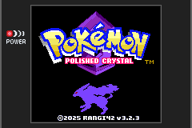

# MiGoomba

A Game Boy / Game Boy Color emulator for the Game Boy Advance. MiGoomba is a fork of
[Jagoomba Color](https://github.com/EvilJagaGenius/jagoombacolor) by Jaga, itself a fork of Dwedit's
Goomba Color (2019-05-04 source), and it keeps the same goal: fix bugs and incompatibilities without
making the emulator slower. Pixel-perfect accuracy is not a goal; the cost on the GBA is measured for
every change.

  

Everything below was measured in mGBA through the headless test tools in `tools/gbtest`, and checked
on a GBA with an EZ-Flash Omega Definitive Edition: saves (including power-offs, quick save/load and
moving saves to and from an EverDrive GB X7), clocks, speed and the display fixes. What still differs
on hardware is listed under known issues below.

## What's new compared with Jagoomba Color

### CPU and timing
- **JR across $FFFF / $0000** wraps correctly in both directions (Polished Crystal crashed).
- **HALT bug** emulated (HALT with interrupts disabled and one pending runs the next byte twice).
- **EI;DI** no longer takes a pending interrupt in between.
- **Interrupt dispatch onto IE**: pushing PC over $FFFF changes IE and the dispatch, as on hardware.
- **Power-on values** for JOYP, SB, IF and DIV.
- **Timer**: the interrupt fires at the scanline start nearest the real overflow (it used to come at
  the end of the line, rounding every period up), and TIMA reads and writes account for the position
  in the line. Games that time raster effects with the timer (Alone in the Dark) now line up.
- **Sprites lengthen mode 3** for STAT reads, as on hardware (about 6 dots each, up to 10 a line),
  approximated for all lines from the busiest 8-line band at each OAM DMA. Turok 3 checks this at
  start-up and showed half a second of red, green and blue screens when it failed.

### Memory, cartridges and I/O
- **MBC1** mode 1 and **MBC1M** multicarts (bank $10 logo detection).
- **MBC2**: register decoding, the built-in 512 x 4-bit RAM, and saves that keep working after
  loading a state.
- Reads with cart RAM disabled return $FF; unused I/O bits read as 1; CGB-only registers read $FF in
  DMG mode; $FF46 returns the last value written.
- **OAM DMA** from echo RAM; OAM reads after a frame no longer return stale data.
- **STAT writes on DMG**: as on the original Game Boy, a write to STAT briefly enables every STAT
  interrupt source, so it raises the interrupt in HBlank, VBlank or on LY=LYC. Road Rash starts its
  road effect with it and used to hang when a race began.
- **HuC-3** (Robot Poncots, Pocket Family GB 2): the clock controller behind $A000 is emulated, and
  the cart's RAM is battery-backed RAM again (cart types $FC-$FF read their flags from past the end
  of a table): Robot Poncots no longer stops after the Hudson logo.
- **HuC-1** (Pokemon Card GB): $4000 selects only the cart RAM bank (it used MBC1's handlers, which
  also switched ROM banks under the game), and $0E at $0000 is the infrared port.

### Video
- **Per-line DMG palettes**: games that rewrite BGP mid-frame (V-Rally's race screen, Lemmings 2) get
  their palette changes on the right lines.
- **Per-line CGB palettes ("hi-colour")**: games that rewrite BG palettes on many lines (Rainbow
  Islands' logo, Tomb Raider, Turok 3, Alone in the Dark, Worms Armageddon) display correctly. Lines
  with identical palettes are merged, and a recorded table is reused on the next frame to keep the
  cost down.
- **DMA to the BG maps** in 16-byte blocks marks the right columns as changed (Turok 3's screens had
  their right half missing).
- The display DMAs are re-armed every frame, so a disturbed raster effect can no longer leave the
  screen striped.
- The whole BG map is drawn once after a reset, so map cells a game never writes show colour 0 instead
  of the backdrop (ragged black bands on Turok 3's white Bit Managers screen).

### Saves
- **32KB cart RAM survives a power-off** (Pokemon Gold/Silver/Crystal, Polished Crystal, ...). Goomba
  used to write it to the GBA save only when its menu was opened, so saving in the game and switching
  off lost the save. With 64KB of GBA SRAM, the running game's cart RAM is now written through to the
  GBA save as it changes. See [Saves](#saves).
- **`tools/goombasave.py`** moves saves between MiGoomba and plain Game Boy saves (real cartridges,
  EverDrive GB, emulators). See [Moving saves](#moving-saves).
- **Saved states** keep the sprites the game sees: a quick load could bring back older sprite
  positions (Turok 3's picture borders, made of sprites, disappeared until the next picture).

### Robustness and speed
- Per-scanline bookkeeping trimmed (-1.6% emulation time on Polished Crystal); 240 bytes of IWRAM
  freed so the stack no longer overwrites the tile decode table.
- The EWRAM layout keeps the per-line palette data clear of the memory the save code borrows.
- **EWRAM speed** option (menu, Speed Hacks): EWRAM with 1 wait state instead of 2 makes emulation
  1-5% faster (Turok 3 -5%, Super Mario Land 2 -3%, Polished Crystal -3%). It works on the original
  GBA; the GBA Micro and the DS crash with it, so it is off at every power-on and never saved.
- Builds with GCC 14 and later, in one pass.

## Compatibility

### Test ROM suites
From [c-sp/game-boy-test-roms](https://github.com/c-sp/game-boy-test-roms) v7.0, run headless in mGBA
(`tools/gbtest/runtests.py`). Jagoomba Color was built from its last commit with only the two build
fixes applied.

| Suite | Jagoomba Color | MiGoomba |
|---|---|---|
| Blargg | 1/9 | 1/9 |
| Mooneye Test Suite | 29/112 | 43/112 |
| Mooneye (wilbertpol) | 8/116 | 12/116 |
| GBMicrotest | 75/513 | 136/513 |
| SameSuite | 1/78 | 1/78 |
| AGE | 0/47 | 0/47 |
| Mealybug Tearoom | 0/35 | 0/35 |
| cgb-acid2 / dmg-acid2 | 0/2 | 0/2 |
| MBC3 tester (banking, type $11) | 1/1 | 1/1 |
| rtc3test (MBC3 clock) | 0/3 | 0/3 |
| **Total** | **115/916** | **194/916** |

Blargg's cpu_instrs passes. Most remaining failures need cycle-exact timing (PPU modes within a
scanline, the DIV/timer coupling), which Goomba trades for speed.

### Games
106 commercial games picked for being hard to emulate, from many regions (USA, Europe, Japan, Korea
and single-country releases) and covering 17 of the 26 cartridge types (one game for each type the
collections had: no MMM01, MBC2 without battery, MBC3 without RAM, Pocket Camera or TAMA5 game), all
run through the same input script (wait for the intro, alternate Start and A for 20 seconds,
screenshots at 7 moments up to Game Boy frame 2400) by `tools/gbtest/gametests.py`. ROMs are not part
of the repository; they are identified by hash.

- **Stuck games**: the screen stops changing over the last checkpoints while the reference's goes
  on (`STUCK`), or the cart RAM is set up differently from what the ROM header says (`CART`).
  Jagoomba Color: Robot Poncots and Pocket Family GB 2 (CART), Rayman 2, Bomberman Selection, Road
  Rash, Kirby's Dream Land 2 and Net de Get. MiGoomba: Kirby's Dream Land 2 (a false
  alarm: the start-up runs ahead of the reference, so the scripted presses leave Kirby waiting at the
  hub) and Net de Get (MBC6, not supported).
- **Reference**: screenshots that match mGBA's own Game Boy core (on the CGB, SGB or DMG model
  MiGoomba picks), allowing for different colours and not counting blank screens: **324/742 for
  Jagoomba Color, 378/742 for MiGoomba**. 19 games improve; F1 Championship Season, Harvest Moon 3
  and Lufia each catch a different animation step at one or two checkpoints since sprites lengthen
  mode 3 (their screens look the same otherwise). Input timing differs by a frame or so between the
  two emulators, and SGB games differ wherever borders and palettes do, so a low number is a lead to
  look at rather than a failure (Adventures of Lolo plays fine but differs in its SGB colours).
- **GBA load**: emulation time per Game Boy frame as a share of a real GBA's frame time. Above 100%
  the game runs slower than full speed: Alfred's Adventure, Harry Potter, Perfect Dark, SWIV and Tomb
  Raider; Alone in the Dark and F1 Championship Season are right at 100%. The EWRAM speed option
  lowers these by a few percent.

Games that improved (reference checkpoints): Pocket Family GB 2 (0 -> 7), Robot Poncots (0 -> 4) and
Pokemon Card GB (0 -> 6), which stopped after their first screens; Road Rash, which hung when a race
started (its screens match the reference apart from the bottom row); Turok 3 (0 -> 5), Tomb Raider (0
-> 4), Suzuki Alstare Extreme Racing (1 -> 5), Carmageddon (2 -> 6), Star Hawk (2 -> 6), Inspector
Gadget (2 -> 5), Bomberman Selection (0 -> 3), Rayman 2 (0 -> 3), Alone in the Dark (5 -> 7), Driver
(4 -> 6), Medarot 5 (2 -> 4), and one more each for Cannon Fodder, Donkey Kong Country, Final Fantasy
Adventure, Ninja JaJaMaru DX and Robin Hood.

Known issues: Net de Get needs the MBC6 mapper; no tilt input for Korokoro Kirby (MBC7) and no
infrared (Robot Poncots' GB KISS, Pocket Family GB 2, Chee-Chai Alien); the HuC-3 clock is not kept
across power-offs; the MBC3 clock reads the GBA cart's clock but can't be stopped or set (rtc3test);
3-D Ultra Pinball and The Smurfs' Nightmare differ from the reference at every checkpoint and have not
been looked into yet. Sprite palettes (OBP0/OBP1) are one per frame, so V-Rally's menu can't fade one
item at a time. On real hardware only: the lower half of Worms Armageddon's language screen blinks,
and Turok 3's pictures get a stray line at the top (both use per-line palettes, which may come late
there).

A black, silent screen after 5 minutes without input is the menu's Autosleep (5 minutes by default),
not a crash: Start+Select wakes the GBA, and the menu sets 10 or 30 minutes or off.

All 106 games

| Game | Mode | Reference (Jagoomba Color) | Reference (MiGoomba) | GBA load |
|---|---|---|---|---|
| 3-D Ultra Pinball - Thrillride (USA) (Rumble Version) | CGB | 0/7 | 0/7 | 49% |
| Adventures of Lolo (Europe) (SGB Enhanced) | SGB | 0/7 | 0/7 | 41% |
| Alfred's Adventure (Europe) (En,Fr,De,Es,It) | CGB | 1/7 | 1/7 | 140% |
| Alone in the Dark - The New Nightmare (USA) | CGB | 5/7 | 7/7 | 100% |
| Asterix - Search for Dogmatix (Europe) | CGB | 6/7 | 6/7 | 39% |
| Baby Felix - Halloween (Europe) (En,Fr,De,Es,It,Nl) | CGB | 5/7 | 5/7 | 41% |
| Beatmania GB - Gotcha Mix 2 (Japan) | CGB | 7/7 | 7/7 | 34% |
| Beavis and Butt-Head (USA) | DMG | 7/7 | 7/7 | 28% |
| Bionic Commando - Elite Forces (USA) | CGB | 3/7 | 3/7 | 64% |
| Bomberman Selection (Korea) | CGB | 0/7 | 3/7 | 29% |
| Cannon Fodder (Europe) (En,Fr,De,Es,It) | CGB | 4/7 | 5/7 | 70% |
| Carmageddon - Carpocalypse Now (USA, Europe) (En,Fr,Es,It) | CGB | 2/7 | 6/7 | 70% |
| Chee-Chai Alien (Japan) (Rumble Version) | CGB | 0/7 | 0/7 | 33% |
| Choplifter III (Europe) | DMG | 6/7 | 6/7 | 27% |
| Croc 2 (USA, Europe) | CGB | 5/7 | 5/7 | 32% |
| Dance Dance Revolution GB (Japan) | CGB | 6/7 | 6/7 | 45% |
| Densha de Go! 2 (Japan) | CGB | 2/7 | 2/7 | 35% |
| Donkey Kong Country (USA) | CGB | 1/7 | 2/7 | 58% |
| Donkey Kong Land (USA) (SGB Enhanced) | SGB | 0/7 | 0/7 | 40% |
| Dragon Ball Z - Guerreros de Leyenda (Spain) | CGB | 6/7 | 6/7 | 31% |
| Dragon Ball Z - I Leggendari Super Guerrieri (Italy) | CGB | 5/7 | 5/7 | 31% |
| Dragon Warrior III (USA) | CGB | 5/7 | 5/7 | 52% |
| Driver (Europe) (En,Fr,De,Es,It) | CGB | 4/7 | 6/7 | 55% |
| F1 Championship Season 2000 (Brazil) (En,Fr,De,Es,It) | CGB | 6/7 | 5/7 | 100% |
| Faceball 2000 (USA) | DMG | 6/7 | 6/7 | 54% |
| FIFA 98 - Road to World Cup (Europe) (Rev-A) (SGB Enhanced) | SGB | 0/7 | 0/7 | 25% |
| Final Fantasy Adventure (USA) | DMG | 5/7 | 6/7 | 31% |
| Gradius - The Interstellar Assault (USA) | DMG | 2/7 | 2/7 | 40% |
| Halloween Racer (Europe) | CGB | 2/7 | 2/7 | 70% |
| Harry Potter and the Sorcerer's Stone (USA) | CGB | 4/7 | 4/7 | 134% |
| Harvest Moon 3 GBC (USA) | CGB | 6/7 | 4/7 | 39% |
| Inspector Gadget - Operation Madkactus (Europe) (En,Fr,De,Es,It,Nl) | CGB | 2/7 | 5/7 | 60% |
| John Romero's Daikatana (Europe) | CGB | 4/7 | 4/7 | 49% |
| Keitai Denjuu Telefang - Power Version (Japan) (GB Compatible) | CGB | 6/7 | 6/7 | 31% |
| King of Fighters, The - Heat of Battle (Europe) (SGB Enhanced) | SGB | 1/7 | 1/7 | 65% |
| Kirby's Dream Land 2 (USA) (SGB Enhanced) | SGB | 0/7 | 0/7 | 37% |
| Konami GB Collection Vol.4 (Europe) (GB Compatible) | CGB | 2/7 | 2/7 | 49% |
| Korokoro Kirby (Japan) | CGB | 1/7 | 1/7 | 76% |
| Legend of Zelda, The - Link's Awakening DX (USA, Europe) (Rev 2) (SGB Enhanced) (GB Compatible) | CGB | 2/7 | 2/7 | 41% |
| Legend of Zelda, The - Oracle of Ages (USA) | CGB | 6/7 | 6/7 | 35% |
| Lemmings 2 - The Tribes (Europe) | DMG | 2/7 | 2/7 | 41% |
| Lucky Luke - Desperado Train (Europe) | CGB | 4/7 | 4/7 | 96% |
| Lufia - The Legend Returns (USA) | CGB | 3/7 | 2/7 | 66% |
| Magi Nation (USA) | CGB | 4/7 | 4/7 | 35% |
| Medarot 5 - Susutake Mura no Tenkousei - Kabuto (Japan) | CGB | 2/7 | 4/7 | 64% |
| Mega Man Xtreme (USA) | CGB | 6/7 | 6/7 | 52% |
| Metal Gear - Ghost Babel (Japan) | CGB | 3/7 | 3/7 | 51% |
| Metal Gear Solid (USA) | CGB | 6/7 | 6/7 | 46% |
| Micro Machines 2 - Turbo Tournament (Europe) | DMG | 2/7 | 2/7 | 37% |
| Monster Max (Europe) | DMG | 5/7 | 5/7 | 39% |
| Mr. Driller (USA) | CGB | 1/7 | 1/7 | 92% |
| Mr. Nutz (Europe) | DMG | 1/7 | 1/7 | 31% |
| Net de Get - Minigame @ 100 (Japan) | CGB | 0/7 | 0/7 | 69% |
| Ninja JaJaMaru - The Great World Adventure DX (USA, Europe) (Ninja JaJaMaru Retro Collection) (Switch) | CGB | 3/7 | 4/7 | 59% |
| Oddworld Adventures II (USA, Europe) (En,Fr,De,Es,It) | CGB | 4/7 | 4/7 | 53% |
| Parodius (Europe) | DMG | 2/7 | 2/7 | 44% |
| Perfect Dark (USA) | CGB | 3/7 | 3/7 | 165% |
| Pinball Fantasies (USA) | DMG | 6/7 | 6/7 | 26% |
| Pocket Family GB 2 (Japan) | CGB | 0/7 | 7/7 | 28% |
| Pocket Music (Europe) (En,Fr,De,Es,It) | CGB | 5/7 | 5/7 | 61% |
| Pokemon - Gold Version (USA, Europe) (SGB Enhanced) (GB Compatible) | CGB | 0/7 | 0/7 | 49% |
| Pokemon Card GB (Japan) (SGB Enhanced) (GB Compatible) | CGB | 0/7 | 6/7 | 34% |
| Pokemon Card GB 2 - GR Dan Sanjou! (Japan) | CGB | 6/7 | 6/7 | 47% |
| Pokemon Crystal Version (USA) (Rev-A) | CGB | 1/7 | 1/7 | 44% |
| Pokemon Pinball (USA) | CGB | 1/7 | 1/7 | 49% |
| Pokemon Yellow Version - Special Pikachu Edition (USA) (SGB Enhanced) | CGB | 4/7 | 4/7 | 57% |
| Pop'n TwinBee (Europe) | DMG | 5/7 | 5/7 | 62% |
| Prince of Persia (USA, Europe) (En,Fr,De,Es,It) (GB Compatible) | CGB | 1/7 | 1/7 | 54% |
| R-Type II (Europe) | DMG | 4/7 | 4/7 | 46% |
| Rainbow Islands (Europe) (En,Fr,De,Es,It) | CGB | 4/7 | 4/7 | 39% |
| Rayman 2 (USA) (En,Fr,De,Es,It) | CGB | 0/7 | 3/7 | 52% |
| Resident Evil Gaiden (Europe) (En,Fr,De,Es,It) | CGB | 5/7 | 5/7 | 48% |
| Road Rash (USA) | DMG | 1/7 | 1/7 | 56% |
| Robin Hood (Europe) (En,Fr,De,Es,It,Nl) | CGB | 6/7 | 7/7 | 33% |
| Robot Poncots - Sun Version (Japan) (SGB Enhanced) (GB Compatible) | CGB | 0/7 | 4/7 | 49% |
| Sakura Taisen GB 2 - Thunderbolt Sakusen (Japan) | CGB | 2/7 | 2/7 | 36% |
| San Francisco Rush - Extreme Racing (USA) (Proto) | CGB | 6/7 | 6/7 | 84% |
| Sensible Soccer - European Champions (Europe) | DMG | 3/7 | 3/7 | 23% |
| Shantae (USA) | CGB | 3/7 | 3/7 | 77% |
| Shin Megami Tensei Devil Children - Shiro no Sho (Japan) | CGB | 4/7 | 4/7 | 62% |
| Smurfs Nightmare, The (Europe) (En,Fr,De,Es) | CGB | 0/7 | 0/7 | 29% |
| Space Station Silicon Valley (Europe) | CGB | 2/7 | 2/7 | 33% |
| Star Hawk (Europe) | DMG | 2/7 | 6/7 | 21% |
| Star Wars Episode I - Racer (USA) | CGB | 5/7 | 5/7 | 36% |
| Super Mario Bros. Deluxe (USA) (Rev-B) | CGB | 7/7 | 7/7 | 37% |
| Super Mario Land 2 - 6 Golden Coins (USA) (Rev-B) | DMG | 1/7 | 1/7 | 31% |
| Suzuki Alstare Extreme Racing (Europe) (En,Fr,De,Es,It,Nl) | CGB | 1/7 | 5/7 | 71% |
| SWIV (Europe) (En,Fr,De,Es,It) | CGB | 2/7 | 2/7 | 120% |
| Test Drive 2001 (USA) | CGB | 4/7 | 4/7 | 68% |
| Tetris (USA) (Rev-A) | DMG | 5/7 | 5/7 | 19% |
| Tintin in Tibet (Europe) (SGB Enhanced) | SGB | 0/7 | 0/7 | 35% |
| Toki Tori (USA, Europe) (En,Ja,Fr,De,Es) | CGB | 5/7 | 5/7 | 27% |
| Tomb Raider (USA) | CGB | 0/7 | 4/7 | 162% |
| Top Gear Pocket (USA) | CGB | 3/7 | 3/7 | 73% |
| Trip World (Europe) | DMG | 3/7 | 3/7 | 19% |
| Trip World DX (USA) (Limited Run Games) | CGB | 3/7 | 3/7 | 24% |
| Turok 3 - Shadow of Oblivion (USA) | CGB | 0/7 | 5/7 | 84% |
| V-Rally - Championship Edition (Europe) | DMG | 0/7 | 0/7 | 56% |
| Vigilante 8 (USA) (Rumble Version) | CGB | 5/7 | 5/7 | 51% |
| Visiteurs, Les (France) (GB Compatible) | CGB | 5/7 | 5/7 | 78% |
| Wario Land 3 (USA) | CGB | 2/7 | 2/7 | 40% |
| Wario Land II (USA) (SGB Enhanced) | SGB | 0/7 | 0/7 | 29% |
| Wendy - Der Traum von Arizona (Germany) | CGB | 5/7 | 5/7 | 84% |
| Worms (Europe) | DMG | 6/7 | 6/7 | 31% |
| Worms Armageddon (Europe) (En,Fr,De,Es,It,Nl) | CGB | 4/7 | 4/7 | 43% |
| Xtreme Sports (USA) | CGB | 1/7 | 1/7 | 42% |

## Building

- Install devkitPro's GBA tools (devkitARM). On Windows, use the devkitPro MSYS2 shell.
- Run `make` in this directory. It produces `migoomba.gba` (the emulator) and `migoomba.elf` (the same
  with debug symbols).

There are two builds for EZ-Flash Omega carts, each with its own output file and build directory:

| Command | Output | For | Differences |
|---|---|---|---|
| `make` | `migoomba.gba` | any cart | |
| `make VARIANT=ezo` | `migoomba_ezo.gba` | EZ-Flash Omega | assumes the cart has a clock instead of detecting it; settings aren't written to the save when leaving the menu |
| `make VARIANT=ezode` | `migoomba_ezode.gba` | EZ-Flash Omega Definitive Edition | assumes the cart has a clock; rumble games also drive the cart's rumble |

The hardware checks in this README used the regular build on an Omega Definitive Edition, where it works
fine: that cart only needs `ezode` for rumble. The two Omega builds have only been run in mGBA.

`.github/workflows/build.yml` builds all three on every push to master and publishes them as a release
when a `v*` tag is pushed.

### Making a playable ROM

A playable GBA ROM is just the emulator with the Game Boy ROM appended:

    cat migoomba.gba game.gbc > game.gba

`make` does it too, building the emulator first if needed and writing to this directory, and it can
put several games on one cart, with a menu to pick them (what Goomba Front used to build):

    make path/to/game.gbc [OUT=name.gba]               # -> game.gba
    make game1.gbc game2.gb game3.gbc [OUT=name.gba]   # -> compilation.gba, games in this order

Each ROM is padded, or cut, to the size its header declares, since the emulator finds the next game by
that size; the menu shows the names from the ROM headers, and the result must fit in a GBA cart's 32MB.
make splits its arguments at spaces, so rename files with spaces in their names first (or use `cat`
for a single game). Goomba Front's "trimmed" ROMs, which save space by dropping unused banks, are not
made.

For debug symbols in mGBA, put `migoomba.elf` next to the built ROM and rename it to
`(ROM name).elf` (thanks to Endrift for the tip).

The ROM header keeps Goomba's title and game code (`GOOMBA COLOR`, `GMBC`), so kernels and emulator
settings that recognise Goomba builds still do.

## Saves

MiGoomba keeps everything in the GBA save (the flash cart's or emulator's SRAM): saved states and
every game's cart RAM, LZO-packed and found by a checksum of the game's ROM. The running game's cart
RAM is also written through as it changes, so it survives a power-off and is packed on the next boot:

| Game's cart RAM | 64KB GBA SRAM (most flash carts) | 32KB GBA SRAM |
|---|---|---|
| up to 8KB | written through | written through |
| 32KB | written through, if saved states and other saves fit in the first 32KB (with 4KB to spare) | saved when the menu (L+R) opens |

In the last case, open the menu after saving in a 32KB game before switching off. The menu also packs
the save and gives the whole SRAM back to saved states while it is open.

**Flash carts**: the EZ-Flash Omega Definitive Edition keeps saves in FRAM; leave it about ten seconds
after saving before switching off.

**mGBA** gives GBA games 32KB of SRAM unless told otherwise. For 64KB, stop the game (File -> Close
ROM), open Tools -> Game Overrides, set Save type to "SRAM 64kB (bootlegs only)", Save, and load the
ROM again; or, with mGBA closed, add to `~/.config/mgba/config.ini`:

    [override.GMBC]
    savetype=SRAM512

### Moving saves

`tools/goombasave.py` (Python 3, no dependencies) converts a game's save between MiGoomba's GBA save
and a plain Game Boy save: real cartridges (read with a cart dumper), the EverDrive GB X7 and Game Boy
emulators.

    python3 tools/goombasave.py list   GOOMBA.sav [GAME.gbc ...]
    python3 tools/goombasave.py export GOOMBA.sav GAME.gbc GAME.sav
    python3 tools/goombasave.py import GOOMBA.sav GAME.gbc GAME.sav [--delete-states]

It needs the game's ROM to find its save, and keeps `GOOMBA.sav.bak` when importing. Saved states
hold their own copy of cart RAM: loading an older state after an import brings the older save back
(`--delete-states` removes that game's states). MBC3 clock data is not transferred; MiGoomba uses the
GBA's clock.

## Testing

`tools/gbtest` runs MiGoomba headless in libmgba, with exact cycle counts:

- `runtests.py`: the test ROM suites above; `diffruns.py` compares two runs, emulation cost included.
- `gametests.py`: the game checks above, against a baseline of screen hashes in `games.json` and
  against mGBA's Game Boy core (`gbref`). Besides changes from the baseline and hangs it reports
  games stuck on one screen while the reference goes on (`STUCK`) and cart RAM or battery set up
  differently from the ROM header (`CART`); known cases carry their reason in `games.json`.
- `savetest.py`, `goombasave_test.py`: battery saves across power cycles, quick save/load and the
  menu, on 32KB and 64KB of GBA SRAM, and round trips through `goombasave.py`.
- `stackcheck.py`: stack headroom in IWRAM. `profile.py`: where the time goes.
- `hwkit.py`: a kit for checking a build on real hardware: games and test ROM compilations to copy
  to the flash cart, what mGBA showed for each, and a checklist to fill in (written to `hwtest/`,
  which git ignores as it holds commercial games).

See [tools/gbtest/README.md](tools/gbtest/README.md) for setup and details, and
[AGENTS.md](AGENTS.md) for notes on the code and on how changes are made and measured.

## Thanks

- Jaga (EvilJagaGenius) for [Jagoomba Color](https://github.com/EvilJagaGenius/jagoombacolor), which
  MiGoomba is built on, and its fixes, among them: Donkey Kong Land: New Colors Mode (file select
  menu), Faceball 2000 (menu), Kirby's Dream Land DX Service Repair (level 2 palettes), Konami GB
  Collections 2 and 4 (boot), Metal Gear Solid: Ghost Babel (elevator crash), Pokemon Crystal
  (graphical corruption) and Wario Land DX (boot).
- Dwedit for the Goomba Color emulator: https://www.dwedit.org/gba/goombacolor.php
- FluBBa for the Goomba emulator before that: http://goomba.webpersona.com/
- Minucce for help with ASM and pointing Jaga in the right direction.
- Sterophonick for code tweaks and featuring Jagoomba in the Simple kernel for the EZ-Flash Omega
  carts: https://gbatemp.net/threads/new-theme-for-ez-flash-omega.520665/
- EZ-Flash for releasing the source to their modified Goomba Color builds.
- Nuvie for the code that saves the desired Game Boy type per game.
- Radimerry for the MGS: Ghost Babel elevator fix, Faceball menu fix, and SMLDX SRAM fix.
- Therealteamplayer for the default-to-grayscale code for GB games if no SGB palette is found.
- Endrift for mGBA, which the test tools are built on.
